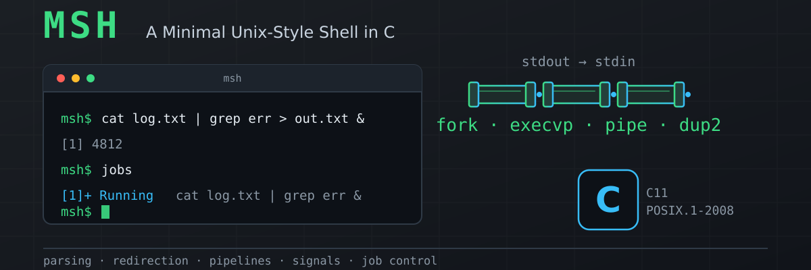

<p align="center">
  
</p>

#  MSH — A Minimal Unix-Style Shell in C

[](https://github.com/AJC938/msh/actions/workflows/ci.yml)
[](LICENSE)
[](https://en.cppreference.com/w/c/11)
[](https://pubs.opengroup.org/onlinepubs/9699919799/)

|  |  |
| --- | --- |
| **Project** | MSH — a minimal Unix-style shell |
| **Language** | C11 (`-std=c11`), no third-party libraries |
| **Domain** | Linux / POSIX systems programming |
| **Purpose** | an educational user-space shell implementation |

A minimal Unix-style interactive shell written in **C11** against
**POSIX.1-2008** interfaces. Parsing, redirection, pipelines, signals and job
control are implemented directly on `fork`, `execvp`, `pipe`, `dup2`,
`waitpid`, `setpgid` and `tcsetpgrp` — nothing is delegated to `system()`,
`popen()`, or another shell.

> **This is an educational minimal shell, not a Bash replacement.** It does not
> implement the POSIX shell command language. It implements a small,
> deliberately chosen subset, and the boundary is written down rather than left
> to be discovered — see [docs/requirements.md](docs/requirements.md), which
> states the non-requirements as explicitly as the requirements.

Built as a portfolio project, with correctness, honest verification and clear
module boundaries valued above feature count.

---

## Contents

- [What it does](#what-it-does) · [Build and run](#build-and-run) · [Usage](#usage)
- [Built-in reference](#built-in-reference) · [Exit status](#exit-status)
- [Architecture](#architecture) · [POSIX interfaces used](#posix-interfaces-used)
- [Tests](#tests) · [Verification status](#verification-status)
- [Known limitations](#known-limitations) · [Licence](#licence)

---

## What it does

**Quoting and words** — a hand-written three-state machine, not `strtok`.
Single quotes are literal; inside double quotes `\"` and `\\` are the only
escapes; a backslash outside quotes escapes anything; adjacent runs
concatenate, so `ab"cd"'ef'` is one word; `''` is a real zero-length argument.
Operators are syntax only when unquoted.

**External commands** — `fork` + `execvp` with a `PATH` search, the exit code
adopted as the shell's status, `128 + n` when a signal killed it, and no
zombies left behind.

**Redirection** — `< file`, `> file`, `>> file`, performed with
`open`/`dup2`/`close` in the child between `fork` and `exec`. Any order, no
whitespace required, quoting applies to the path, built-ins included, and an
explicit redirection overrides a pipe endpoint.

**Pipelines** — `a | b | c`, every stage concurrent, each with its own
arguments and redirections. The status is the last stage's; there is no
`pipefail`.

**Jobs, signals and terminal control** — every job gets **its own process
group**; a foreground job owns the terminal and hands it back on every exit
path; Ctrl+C and Ctrl+Z reach the **whole group**, so interrupting `a | b | c`
stops all three; the shell itself can never be interrupted or stopped. `&`
backgrounds a whole pipeline, and `jobs`, `fg` and `bg` manage what is running.

**Without a terminal** — in a pipe, a script or CI — msh performs no terminal
control at all: no `tcsetpgrp`, no process groups of its own, and
terminal-generated signals keep their default behaviour, so msh dies like any
other program in a pipeline. Jobs are still tracked and `&` still works.

---

## Build and run

Requires Linux (including WSL2), GCC or Clang with C11, and GNU Make.
Optional: GDB, ASan/UBSan, Valgrind.

```sh
git clone https://github.com/AJC938/msh.git
cd msh
make            # optimised build -> out/msh
./out/msh
```

| Target | What it does |
| --- | --- |
| `make` / `make build` | optimised build to `out/msh` |
| `make debug` | `-O0 -g3` build for GDB |
| `make asan` | AddressSanitizer + UndefinedBehaviorSanitizer, then the suite |
| `make test` | unit + integration tests |
| `make test-pty` | terminal tests through a real pty |
| `make valgrind` | memcheck over the execution paths, no suppressions |
| `make clean` | remove `out/` |

The full warning set is on by default: `-Wall -Wextra -Wpedantic -Wshadow
-Wconversion -Wstrict-prototypes -Wmissing-prototypes -Wwrite-strings
-Wpointer-arith -Wcast-qual -Wundef -Wvla`.

---

## Usage

The session below is a **verbatim capture** of msh running at a real pty, not
a reconstruction — `^C` and `^Z` are the terminal echoing the keys:

```
msh$ /bin/echo hello world
hello world
msh$ /bin/echo 'keeps   spacing'
keeps   spacing
msh$ cd /tmp
msh$ /usr/bin/printf 'one\ntwo\nthree\n' > numbers.txt
msh$ /bin/cat < numbers.txt | /usr/bin/grep t | /usr/bin/wc -l
2
msh$ /bin/echo appended >> numbers.txt
msh$ /bin/cat numbers.txt
one
two
three
appended
msh$ /bin/sleep 30 &
[7] 463
msh$ jobs
[7] Running  /bin/sleep 30 &
msh$ fg
/bin/sleep 30 &
^Cmsh$ /bin/sleep 60
^Z[8] Stopped  /bin/sleep 60
msh$ jobs
[8] Stopped  /bin/sleep 60
msh$ bg
[8] /bin/sleep 60 &
msh$ jobs
[8] Running  /bin/sleep 60
msh$ exit
msh: exit: there are jobs still running
[8] Running  /bin/sleep 60
msh$ exit
```

**Ctrl+C** interrupts the foreground job, **Ctrl+Z** stops it, and **Ctrl+D**
at an empty prompt leaves the shell.

If the first job number being `[7]` looks odd, it is not a bug: msh numbers
**every** job it runs, foreground ones included, so by the time the first
background job starts, six foreground jobs have already come and gone. Bash
numbers only the jobs it keeps in the table.

A few behaviours differ from Bash on purpose:

- `&` must be the **last thing on the line**. `a & b` and `a && b` are syntax
  errors, not half-run command lists, because msh has no command lists.
- `a || b` is two pipeline stages with nothing between them — a syntax error.
- `;` is ordinary argument text.
- `> out` with no command is a syntax error, not a way to truncate a file.
- A quoted or escaped operator is plain text: `echo "&"`, `echo '&'` and
  `echo \&` all print `&`.
- A built-in used as a pipeline stage or backgrounded runs **in a child**, so
  `cd /tmp | cat` and `exit &` cannot change or end the shell.
- `exit` refuses **once** while jobs are running and says so; a second `exit`
  leaves anyway. Any command in between clears the warning.

The full list is in
[docs/requirements.md](docs/requirements.md#deliberate-divergences-from-bash).

---

## Built-in reference

| Command | Behaviour |
| --- | --- |
| `cd [dir]` | change the shell's working directory; `$HOME` when bare |
| `pwd` | print the shell's working directory |
| `help` | describe every built-in and the supported syntax |
| `exit [n]` | leave with `n & 255`, or the last status |
| `jobs` | list tracked jobs with id, state and command |
| `fg [%n]` | bring a job to the foreground and wait for it |
| `bg [%n]` | resume a stopped job in the background |

`fg` and `bg` take `%n` or `n`; with no argument they pick the most recently
stopped job, else the most recent one still active.

---

## Exit status

| Situation | Status |
| --- | --- |
| Command exited normally | its own exit code |
| Command killed by signal `n` | `128 + n` |
| Pipeline | the **last stage's** status |
| Foreground job stopped by Ctrl+Z | `128 + SIGTSTP` (**148**) |
| Background launch | 0 |
| Command exists but could not be executed | 126 |
| No such command | 127 |
| Syntax error, or a malformed `exit` argument | 2 |
| A redirection, a built-in, or the shell itself failed | 1 |
| Blank input | previous status, unchanged |

126 and 127 are statements about **the command**, so they are never used for a
failure of the shell's own machinery — that is always 1.

---

## Architecture

```
main.c  ->  shell.c  ->  lineread.c    read one unbounded line
                     ->  parser.c      quote-aware state machine -> pipeline
                     ->  builtins.c    cd, pwd, help, exit, jobs, fg, bg
                     ->  jobs.c        job table, process groups, the terminal
                           -> executor.c   fork / pipe / execvp / waitpid
                                -> redirect.c  open / dup2 / close
                     ->  signals.c     the shell's signal policy
```

```
src/
  main.c         entry point and argument handling
  shell.c/.h     shell state, the REPL, and dispatch — the single seam
  lineread.c/.h  unbounded single-line reader
  parser.c/.h    quote-aware state machine -> pipeline of commands
  builtins.c/.h  the built-in table
  redirect.c/.h  redirection, for a child and for the shell itself
  executor.c/.h  process creation, pipe wiring, status collection
  jobs.c/.h      the job table, process groups, terminal ownership
  signals.c/.h   signal dispositions and SIGCHLD
tests/
  unit/          assertion-based unit tests, no external framework
  integration/   black-box tests, including two real-pty suites
docs/
  architecture.md   how and why it is built this way
  requirements.md   numbered requirements, and the non-requirements
```

Three design points carry most of the weight:

- **`msh_dispatch` is the only seam.** Blank check, then parse, then either a
  lone foreground built-in in the shell process or everything else as a job.
  One place decides, so there is one place to read.
- **A start barrier.** Stages are forked before the parent can call
  `tcsetpgrp`, so a stage could otherwise run — and receive a Ctrl+C — while
  the terminal still belonged to the shell, which ignores it. Children block
  on a pipe until the shell has arranged the terminal.
- **The SIGCHLD handler sets one `volatile sig_atomic_t` flag and nothing
  else.** No `SA_RESTART`, so a blocked read is interrupted and the shell can
  react; the job table is mutated with SIGCHLD blocked.

[docs/architecture.md](docs/architecture.md) covers the module boundaries, the
job model, the signal policy, memory and descriptor ownership, and the defects
this project's own testing exposed.

---

## POSIX interfaces used

Everything is built directly on these; nothing is delegated to `system()` or
`popen()`.

| Area | Interfaces |
| --- | --- |
| Processes | `fork`, `execvp`, `_exit`, `waitpid` (`WNOHANG`, `WUNTRACED`, `WCONTINUED`) |
| Status decoding | `WIFEXITED`, `WEXITSTATUS`, `WIFSIGNALED`, `WTERMSIG`, `WIFSTOPPED`, `WSTOPSIG` |
| Pipes and descriptors | `pipe`, `dup2`, `close`, `open`, `fcntl` (`F_DUPFD_CLOEXEC`) |
| Process groups | `setpgid`, `getpgrp`, `getpid` |
| Terminal control | `isatty`, `tcgetpgrp`, `tcsetpgrp`, `tcgetattr`, `tcsetattr` |
| Signals | `sigaction`, `sigprocmask`, `sigemptyset`, `kill` (to a **process group**) |
| Working directory | `getcwd`, `chdir` |
| Errors in a child | `write`, `strerror_r` — async-signal-safe reporting |

The parts that are easy to get wrong, and how msh handles them:

- **`setpgid` is called in both the parent and the child.** Whichever runs
  first wins; neither can rely on being first, so both do it, and the benign
  races (`EACCES`, `ESRCH`) are distinguished from real failures.
- **`_exit`, never `exit`, in a child** — but `fflush(NULL)` first when the
  child ran a built-in, because `_exit` does not flush stdio and a built-in's
  output would otherwise be silently discarded. (This was a real bug: `pwd |
  cat` printed nothing.)
- **A failed `execvp` reports through `write`**, not `fprintf`, and with
  `strerror_r`, not `strerror`.
- **Saved terminal descriptors use `F_DUPFD_CLOEXEC`** at fd 10 or above, so
  they are not inherited.
- **Signals go to the process group** (`kill(-pgid, ...)`), which is what makes
  interrupting a whole pipeline work.
- **No `SA_RESTART`**, deliberately: the shell needs its blocked read to be
  interrupted so it can react to a finished job.
- **At startup the shell claims the terminal rather than looping on SIGTTIN**,
  and disables job control if it cannot. The textbook loop can wedge a shell
  with no way to continue it; that trade-off is argued in the architecture doc.

---

## Tests

```sh
make test        # unit + integration
make test-pty    # terminal behaviour through a real pty
make asan        # ASan + UBSan over the whole suite
make valgrind    # memcheck, no suppression file
```

- **Unit** (`tests/unit/`, 84 checks) — the line reader; the parser (quoting,
  redirection, pipelines, background, every syntax error, and cleanup after a
  failure 200 stages in); the redirect module, checking descriptor identity
  with `fstat` and counting `/proc/self/fd`; the executor, including a real
  `fork()`-failure test induced with `RLIMIT_NPROC`; and the built-ins,
  including a `getcwd` failure induced by removing the working directory.
- **Integration** (`tests/integration/*.sh`, 317 checks) — input and EOF,
  external execution, built-ins, quoting, redirection, pipelines, and job
  control: background execution, the job table, `fg`/`bg` argument handling,
  the exit policy, and non-interactive safety.
- **Terminal** (`make test-pty`, 33 checks) — `forkpty()` suites for the
  things only a real terminal can show: Ctrl+D, Ctrl+C, Ctrl+Z, `fg`, `bg`,
  terminal ownership before and after every transition, and that a pipeline
  stage runs in its own process group. Ctrl+C is not a character a program
  reads — the line discipline turns it into SIGINT aimed at the terminal's
  foreground process group — so a piped stdin cannot test any of this.
- **Memcheck** (`make valgrind`, 80 checks) — with **no suppression file**, by
  design: a suppression broad enough to quiet the noise would also hide a real
  msh defect.

Every msh invocation in the test suites runs under a **bounded timeout, and a
timeout is reported as a failure**, so a shell that deadlocked fails the suite
instead of hanging it.

---

## Verification status

Measured on 2026-10-26 on Ubuntu 24.04.5 LTS (WSL2, kernel
6.18.54.1-microsoft-standard-WSL2), GCC 13.3.0, GNU Make 4.3, Valgrind 3.22.0.
Every row was produced by running the command and reading its output.

| Check | Result |
| --- | --- |
| Clean build, full warning set **+ `-Werror`**, GCC | **PASS** — 0 warnings |
| `make test` — unit (84) | **PASS** |
| `make test` — integration (317) | **PASS** |
| `make test-pty` — real terminal (33) | **PASS** |
| **`test_pty_jobs` run 20× back to back** | **PASS — 20 of 20, 600/600 checks, 0 timeouts** |
| `make asan` — ASan + UBSan over the whole suite | **PASS** — no diagnostics |
| `make valgrind` — memcheck, no suppressions (80) | **PASS** — 0 errors |
| Suppression file absent | **PASS** |
| Zombies after the suite | **none** (0 defunct of 36 processes examined) |
| Secret scan, machine paths, generated files | **PASS** |
| Clean build + full suite, **Clang** | **see below** |

**No test reports a skip.** Totals: **401 checks in `make test`**, 33 in
`make test-pty`, 80 in `make valgrind`.

**Clang is not verified locally.** Clang is not installed in the environment
this was developed in, and installing it needs privileges that were not
available, so no local Clang result is claimed here. Clang is built and the
full suite run against it by the CI workflow
([`.github/workflows/ci.yml`](.github/workflows/ci.yml)), whose `build + test
(clang)` job is the evidence — see the Actions tab for the current result.

What is *not* verified at all is listed honestly in
[docs/architecture.md](docs/architecture.md#not-covered-and-honestly-so):
induced `setpgid`/`tcsetpgrp`/`dup2`/`waitpid` failures, a mid-pipeline
`pipe()` or `fork()` failure, and a separate pty test for SIGQUIT.

### The pty suite was flaky; it is not any more

It was treated as a release blocker and traced to the end. Two causes were
found, **both in the test rather than in the shell**:

1. A **`fork` wedged in uninterruptible sleep** on this kernel. Catching a
   hung run and reading `/proc` showed the job's group leader in state `D` at
   `wchan kernel_clone`, with SIGTSTP sitting *undeliverable* in its pending
   mask while the process it had forked had stopped normally. The terminal
   generated the signal and the kernel queued it; a process in state `D`
   simply cannot take it, or be killed. msh was in `do_wait` with exactly the
   right signal dispositions. The harness no longer provokes that fork.
2. A **synchronisation defect**: one check sampled terminal ownership as soon
   as `/bin/echo` printed, but `/bin/echo` is itself a foreground job that
   owns the terminal while it prints. It now waits for the prompt, which is
   the event that proves the shell has taken the terminal back.

A control experiment pointed the same way before either fix: driving
`/bin/bash` through the same harness, Ctrl+C worked in **9 of 12** runs,
against **11 of 12** for msh. When the reference implementation is the *less*
reliable of the two, the harness is what to examine.

No timeout was raised, no sleep was added, and the suite was never moved out
of `make test-pty`. The full evidence is in
[docs/architecture.md](docs/architecture.md#the-flaky-pty-suite-diagnosed-and-fixed).

---

## Known limitations

| Not supported | Notes |
| --- | --- |
| Command lists and logical operators (`&&`, `\|\|`, `;`) | `;` is argument text; `&&` is a syntax error |
| stderr redirection (`2>`), heredocs (`<<`), `>&` | out of scope |
| Variable expansion (`$VAR`, `$?`), command substitution | not implemented |
| Globbing (`*`, `?`, `[]`), brace and tilde expansion | not implemented |
| Comments (`#`) | not implemented |
| `pipefail` | deliberately not implemented |
| `kill`, `disown`, `wait`; job specs beyond `%n` | not implemented |
| Shell functions, aliases, `source`, running a script file | not implemented |
| Command history, line editing, tab completion | not planned |

Also absent: `cd -` / `$OLDPWD`, `pwd -L` / `-P`, and any way to print `$?`.

The natural next steps, in order of how much they would be used: variable
expansion (`$?`, `$HOME`) and with it a `kill` built-in; then command lists
(`;`, `&&`, `||`), which the parser is already shaped for — a list of
pipelines rather than a single one.

---

## Licence

[MIT](LICENSE). Chosen as a permissive licence appropriate for a portfolio
project that others may read, copy and learn from. No licence existed in the
repository before this release.
